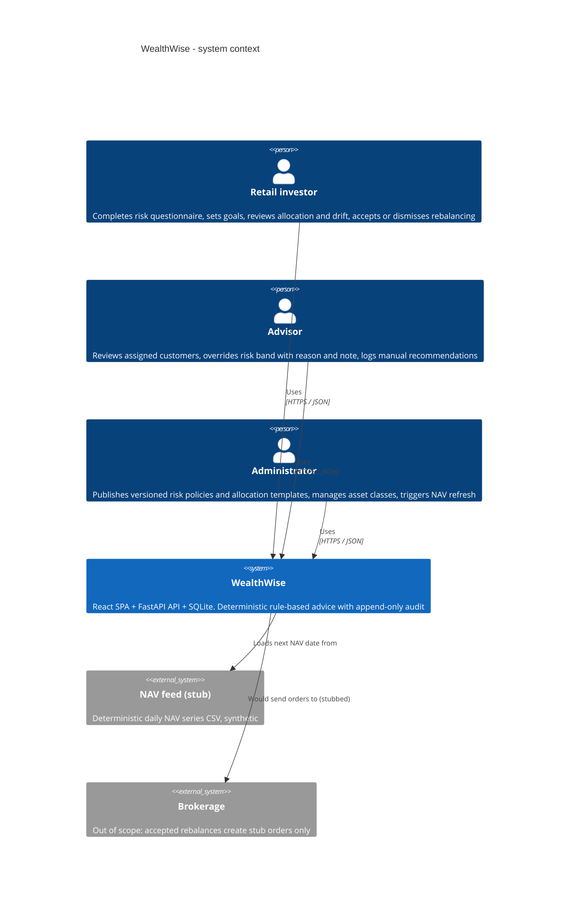
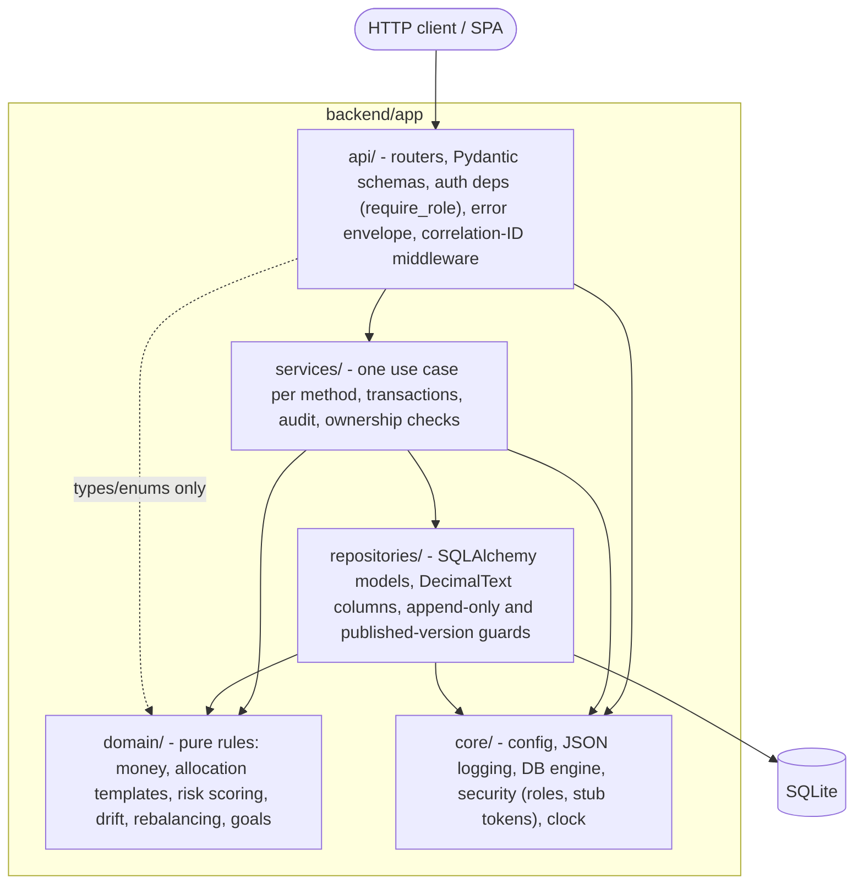
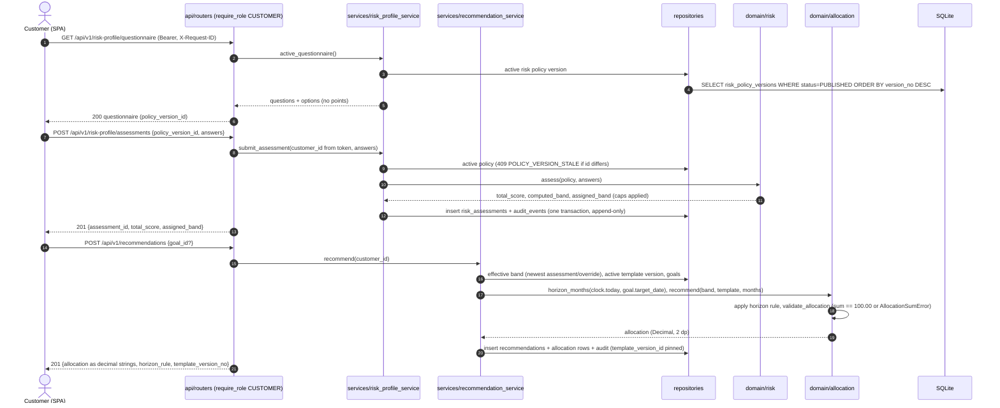

# WealthWise architecture

**Audience:** engineers new to the codebase. **Sources of truth:** `specs/app_spec.md` §4–5 (architecture, cross-cutting rules), `backend/.importlinter`, `tests/architecture/`.

Status markers: ✅ implemented in Phase 03 · 🔜 specified, built in later phases.

## 1. System context (C4 level 1)



## 2. Containers

| Container | Tech | Location | Status |
|---|---|---|---|
| Single-page app | React 19 + Vite + TypeScript | `frontend/` | ✅ shell with responsive layout and live `/health` badge |
| API | FastAPI on uvicorn, Python 3.12 | `backend/app/` | ✅ `/health`, `/api/v1/auth/whoami`, auth roles, JSON logs |
| Database | SQLite through SQLAlchemy 2.x; Alembic migrations (append-only) | `backend/wealthwise.db`, `backend/migrations/` | ✅ engine and session; 🔜 migrations |

The SPA dev server proxies `/api` and `/health` to the API on port 8000 (`frontend/vite.config.ts`).

## 3. Layered structure (backend)



**Rules:**
- **Dependencies point downward:** api → services → repositories → domain.
- **Repositories sit behind services:** the API never imports a repository.
- **The domain has no framework imports:** no FastAPI, Starlette, SQLAlchemy or Pydantic, and no `app.core`.
- **`core` imports no application layer.**

| Rule | Enforced by |
|---|---|
| Layer order (api > services > repositories > domain) | `backend/.importlinter` contract `layers`; `tests/architecture/test_layering.py` (import-linter run plus an independent AST scan) |
| Domain is pure | `.importlinter` `domain-pure`; `tests/architecture/test_domain_has_no_framework_imports.py` (stdlib + `app.domain` only) |
| `core` is independent | `.importlinter` `core-independent` |
| API doesn't import repositories | `.importlinter` `api-not-repositories` (direct imports) and the AST scan |
| No float in money code (NFR-01) | `tests/architecture/test_no_float_money.py` (AST: `float`, float literals, `Float`/`Numeric`/`REAL`); `.claude/hooks/no-float-money-check.js` at edit time |
| Templates sum to exactly 100.00 (NFR-08, AC-02) | `app/domain/allocation/templates.py`; `tests/architecture/test_allocation_sum_invariant.py`; `allocation-sum-invariant-check.js` hook |
| Published templates immutable (NFR-08, AC-10) | `app/repositories/guards.py` ORM listeners; `tests/architecture/test_published_templates_immutable.py`; `template-immutability-check.js` hook |

### What each package holds today

| Package | Modules (✅ = Phase 03) |
|---|---|
| `domain/` | ✅ `money.py` (`to_decimal`, `q2` half-even, `q4_down`); ✅ `allocation/templates.py` (`parse_percentage`, `validate_allocation`, `parse_template_set`); ✅ `policy.py` (`PolicyStatus`); 🔜 `risk/`, `allocation/horizon.py`, `allocation/recommend.py`, `portfolio/`, `rebalancing/`, `goals/` |
| `repositories/` | ✅ `base.py`, `models/template_version.py`, `guards.py` (`PublishedVersionMutation`), `health_repository.py`; 🔜 append-only guard and feature repositories |
| `services/` | ✅ `health_service.py`; 🔜 one service per feature (`backend/app/services/CLAUDE.md`) |
| `api/` | ✅ `deps.py` (`get_db`, `current_principal`, `require_role`), `errors.py`, `middleware.py`, `routers/health.py`, `routers/auth.py` |
| `core/` | ✅ `config.py`, `logging.py` (JSON, allow-listed keys, correlation-ID context), `db.py` (`DecimalText`), `security.py` (roles, stub tokens), `clock.py` |

## 4. Cross-cutting mechanisms

| Concern | How | NFR |
|---|---|---|
| Authentication boundary | `api/deps.require_role(*roles)` on every non-public route. Stub bearer tokens (`stub-token-alice`, `-bob`, `-carol` = CUSTOMER; `-dan` = ADVISOR; `-erin` = ADMIN) resolve to a `Principal`. 401 `UNAUTHENTICATED` / 403 `FORBIDDEN_ROLE`. JWT login replaces the stubs later (`app_spec` §5.5). | NFR-04 |
| Correlation IDs | `api/middleware.py` accepts a safe `X-Request-ID` (`[A-Za-z0-9._-]{1,128}`) or generates a UUID4, binds it to a `ContextVar`, echoes it in the response, and logs `request completed` with method, route template, status and duration | NFR-06 |
| Structured logs | `core/logging.JsonFormatter` writes one JSON object per line. Only `ALLOWED_LOG_KEYS` from `extra` are emitted, so names, emails and amounts are dropped even if passed. | NFR-06, NFR-03 |
| Health | `GET /health` → `health_service.check_health` → `health_repository.ping` (`SELECT 1`). Returns 200 `{"status":"ok","db":"connected"}` or 503. Tested to respond within 1 s of startup. | NFR-07 |
| Exact decimals | `domain/money.py` helpers; `core/db.DecimalText` stores quantised TEXT and refuses floats | NFR-01 |
| Errors | `api/errors.py` produces the `{"error": {"code","message","details"}}` envelope for HTTP and validation errors | — |

## 5. Questionnaire → risk band → recommendation (🔜 feature phases)

This is the target flow from `specs/risk_profile_spec.md` and `specs/recommendation_spec.md`. The authentication, middleware and layering it relies on exist now; the risk and recommendation modules arrive in the feature sprints.



**Determinism:** the domain steps (`assess`, `horizon_months`, `recommend`, `validate_allocation`) are pure functions of the policy and template versions, the answers and the clock date. Each recommendation stores the version IDs it used, so in-flight customers keep their advice when new versions are published (AC-10).

## 6. Frontend

| Item | Detail |
|---|---|
| Entry | `src/main.tsx` → `src/app/App.tsx` (app shell) |
| API client | `src/api/client.ts`: `buildHeaders` (bearer token + `X-Request-ID`), `fetchHealth` (typed, tolerant of 503) |
| Responsive layout | `src/app/styles.css`: sidebar grid on desktop; stacked header/nav/main with a horizontally scrolling nav at ≤ 640 px; 44 px tap targets |
| Rules | No money arithmetic in TS (decimals arrive as strings); strict TS, no `any`; `no-console` lint rule (NFR-03) |

## 7. Quality gates

```bash
cd backend && poetry run pytest ../tests           # unit + integration + architecture, coverage → coverage.xml
cd backend && poetry run lint-imports              # 4 layer contracts
cd backend && poetry run mypy                       # strict
cd backend && poetry run ruff check app ../tests && poetry run ruff format --check app ../tests
cd frontend && npm run typecheck && npm test && npm run lint && npm run build
```
