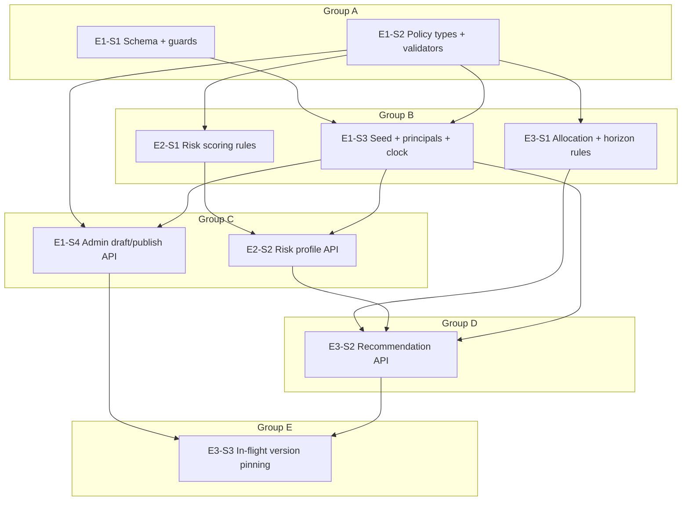

# Sprint 1 dependency graph

**Scope:** AC-01, AC-02, AC-04, AC-10 (versioning foundations). **Out of scope:** AC-03 goal CRUD (goals are seeded, read-only), AC-09 overrides, holdings/drift/rebalancing, asset-class admin API, NAV refresh.

Order: foundation (persistence, seed, versioning) → risk profile → recommendation (it needs the effective band).

## Epics

| Epic | Title | Stories |
|---|---|---|
| E1 | Versioning & seed foundation | E1-S1, E1-S2, E1-S3, E1-S4 |
| E2 | Risk profile | E2-S1, E2-S2 |
| E3 | Recommendation | E3-S1, E3-S2, E3-S3 |

## Groups

### Group A (no dependencies)

| Story | Title | Layer | Depends on |
|---|---|---|---|
| E1-S1 | Persistence schema, Alembic baseline and append-only / immutability guards | Repository | - |
| E1-S2 | Policy definition types and publish validators | Types | - |

### Group B

| Story | Title | Layer | Depends on |
|---|---|---|---|
| E1-S3 | Seed data migration, customer principals and injectable clock | Config | E1-S1, E1-S2 |
| E2-S1 | Deterministic risk scoring rules | Types | E1-S2 |
| E3-S1 | Allocation template and goal-horizon rules | Types | E1-S2 |

### Group C

| Story | Title | Layer | Depends on |
|---|---|---|---|
| E1-S4 | Admin draft / publish API for risk policies and template versions | API | E1-S2, E1-S3 |
| E2-S2 | Risk profile API: questionnaire, assessments, effective band and history | API | E2-S1, E1-S3 |

### Group D

| Story | Title | Layer | Depends on |
|---|---|---|---|
| E3-S2 | Recommendation API: generate, latest and list | API | E3-S1, E2-S2, E1-S3 |

### Group E

| Story | Title | Layer | Depends on |
|---|---|---|---|
| E3-S3 | In-flight customers keep their policy and template versions | API | E1-S4, E3-S2 |

## Graph

No cycles: every edge goes from a lower group letter to a higher one.

## Scenario coverage

| Scenario | Stories |
|---|---|
| AC-01.1 | E1-S3, E2-S2 |
| AC-01.2 | E2-S1, E2-S2 |
| AC-01.3 | E2-S1 |
| AC-01.4 | E2-S1, E2-S2 |
| AC-01.5 | E2-S1, E2-S2 |
| AC-01.6 | E2-S1, E2-S2 |
| AC-01.7 | E1-S1, E2-S1, E2-S2 |
| AC-01.8 | E2-S2, E3-S3 |
| AC-02.1 | E3-S1, E3-S2 |
| AC-02.2 | E3-S1, E3-S2 |
| AC-02.3 | E3-S1, E3-S2 |
| AC-02.4 | E1-S2, E3-S1, E3-S2 |
| AC-02.5 | E3-S2 |
| AC-04.1 | E3-S1, E3-S2 |
| AC-04.2 | E3-S1 |
| AC-04.3 | E3-S1, E3-S2 |
| AC-04.4 | E3-S1, E3-S2 |
| AC-04.5 | E3-S1 |
| AC-10.1 | E1-S2, E1-S4 |
| AC-10.2 | E1-S4 |
| AC-10.3 | E1-S1 |
| AC-10.4 | E1-S2, E1-S4 |
| AC-10.5 | E3-S3 (drift clause deferred to holdings sprint, AC-05) |
| AC-10.6 | E2-S1, E3-S3 |
| AC-10.7 | E1-S1, E1-S4 |
| AC-10.8 | E1-S4 |

## Assumptions and open questions (for human review)

1. **Domain module paths.** risk_profile §2.6 says `backend/app/domain/risk/`; `backend/app/domain/CLAUDE.md` and the sprint brief name flat modules (`risk_band_rules.py`, `allocation_template_policy.py`, `goal_horizon_policy.py`, `template_version_validator.py`). The flat names are used; the spec's path should be updated.
2. **Seeded goals.** app_spec §5.10 says 2 goals per customer, but AC-02.1/AC-10.5 need alice with no goals. Sprint 1 seeds only frank (1) and grace (2) goals.
3. **`applied_caps`.** Lists a cap only when it lowered the band (E2-S1).
4. **Draft deletion audit.** No action code in admin_versioning §4; none asserted.
5. **Fixed clock seam.** `WEALTHWISE_FIXED_CLOCK` (E1-S3) is a test/evaluator seam not named in the spec; it only feeds the existing `Clock` abstraction (app_spec §5.2).
